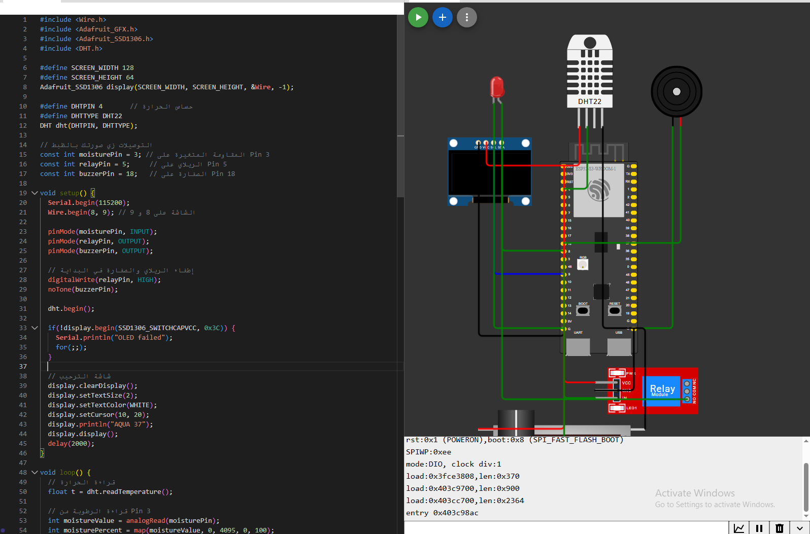

# Aqua 37 - Smart Irrigation System

## Project Overview
Aqua 37 is an IoT-based environmental monitoring system simulated on Wokwi. It uses an ESP32-S3 to read temperature (DHT22) and soil moisture (simulated via a potentiometer). When the moisture drops below 30%, the ESP32 triggers a relay to turn on a water pump (simulated with an LED) and sounds a buzzer alert. The system turns the pump off when moisture exceeds 60% to prevent overwatering.

## Hardware Components (BOM)
* ESP32-S3 Development Board
* 0.96 inch I2C OLED Display (SSD1306)
* DHT22 Temperature Sensor
* Soil Moisture Sensor (Simulated with Potentiometer)
* 1-Channel Relay Module
* 5V Water Pump (Simulated with LED)
* Piezo Buzzer
* Jumper Wires

## Wiring Diagram & Simulation

